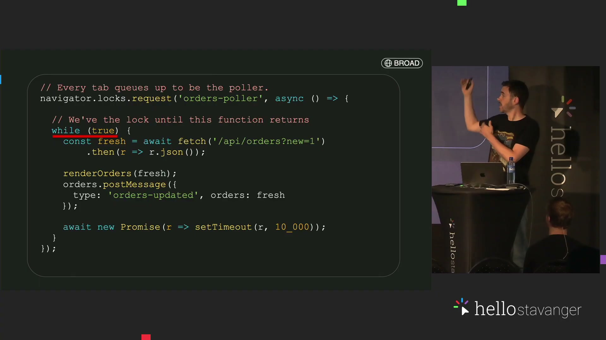
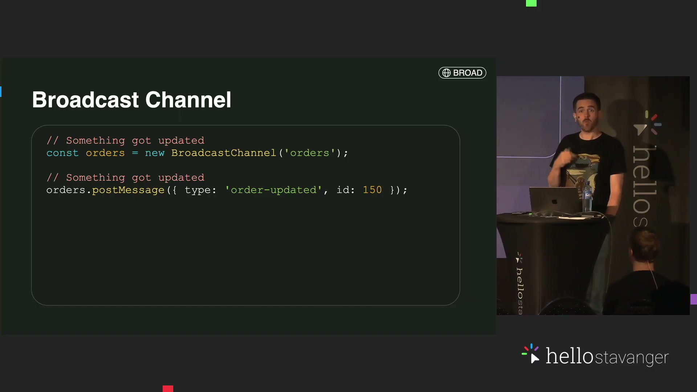

# Replace a dependency with a browser feature—one useful change at a time

Based on [Paul Conroy's *Delete Your Dependencies: What the Browser Can Do Now*](https://www.youtube.com/watch?v=I6tOlNK_HS4), HelloStavanger 2026. Prepared 27 October 2026 for web developers improving an existing app.

You will learn how to recognize a native-browser alternative, decide whether it fits your users, and check the result before removing a library. The title is an invitation to investigate dependencies, not to remove every one.

<section class="guide-context" aria-labelledby="context-title">
<p class="eyebrow">Where this fits</p>
<h2 id="context-title">Web-platform-first development</h2>
<p>Start with the behavior users need and investigate what the browser supplies. Progressive enhancement is a related adoption strategy: keep essential content and functionality usable, then add supported capabilities. A native feature is a candidate to qualify, not proof that every dependency should disappear.</p>
<div class="concept-contrast"><div><strong>Platform capability</strong><p>What can this API or HTML/CSS feature do on the target browser and device?</p></div><div><strong>Adoption strategy</strong><p>What usable path remains when that capability is missing, denied or unsuitable?</p></div></div>
<p class="context-caption">“Web-platform-first” is our descriptive framing. Progressive enhancement is an established principle; neither guarantees compatibility or removes your application’s responsibilities.</p>
<details><summary>Compare related approaches</summary>

| Related direction | The job it serves | Important distinction |
| --- | --- | --- |
| Progressive enhancement | Keep a usable core while adding capabilities | An enhancement must not hide required actions from unsupported users |
| Feature detection | Select a path based on available functionality | Existence alone does not qualify permissions, performance or the full task |
| Dependency evaluation | Decide whether a package fills a real gap | Native and library implementations both need maintenance and behavior checks |
| Browser-local AI | Run an eligible task with an available on-device model | Eligibility, hardware and downloads still matter; keep a useful alternative |

Starting references: [progressive-enhancement definition](https://developer.mozilla.org/en-US/docs/Glossary/Progressive_Enhancement), [Chrome built-in AI](https://developer.chrome.com/docs/ai/built-in) and [its eligibility/setup requirements](https://developer.chrome.com/docs/ai/get-started). These add orientation around the source’s demonstrations; they are not a claim that every API was tested here.

</details>
</section>

## The whole approach at a glance

Start with **one user behavior**, check whether a **native capability fits the target environment**, then add only what is still missing. Keep a usable baseline and verify the behavior before deleting a dependency.

- **Interface (topic 2):** native controls and CSS can replace small UI helpers.
- **Continuity (topics 1, 3–4):** capture a region, coordinate tabs and retain useful context without a wholesale rewrite.
- **Capability limits (topics 5–6):** detection, hardware and AI need their own support, permission and task checks.

Native does not mean universally available or production-ready for your app. The separate two-tab example tests one mechanism, not every feature in the talk.

**Start here:** name one job in your app—keep two tabs current, open a small action panel, or share one part of a screen. Write the behavior your users need and the browsers they use. Choose the smallest native replacement that meets that behavior.

**Want to try something now?** [Open the two-tab coffee-order worked example](#worked-example). It adapts the talk's BroadcastChannel and Web Locks ideas into a small runnable page. No hardware, account, API key or package installation is needed; a local static server is required (Python 3 or an existing static-server tool). It is separate from the lesson and does not implement the creator's complete coffee-shop application.


## 1. Start with the job, not the package

**Break the user’s job into capabilities before searching for a package.**

<figure class="teaching-visual"><div class="visual-flow" role="img" aria-label="Capture, then Select region, then Draw canvas, then Share tab"><span>Capture</span><b aria-hidden="true">→</b><span>Select region</span><b aria-hidden="true">→</b><span>Draw canvas</span><b aria-hidden="true">→</b><span>Share tab</span></div><figcaption>Our decomposition of the creator’s screen-sharing example.</figcaption></figure>

**Try:** Trace capture → select region → draw → share.

**Check:** Permissions, resizing, stopping and supported browsers all meet the job.

**If stuck:** Identify the one remaining capability that justifies a dependency.

<details>
<summary>Why this works · source context</summary>

The opening example is a client demo: show the emulator region, not the entire IDE. Conroy combines screen capture, a selected rectangle and a canvas preview. The transferable move is to break the desired behavior into capabilities before searching for a plugin.

</details>

**In the video:** [1:13—demo problem](https://www.youtube.com/watch?v=I6tOlNK_HS4&t=73s), [3:31—capture and canvas](https://www.youtube.com/watch?v=I6tOlNK_HS4&t=211s), [7:50—dependencies can still be necessary](https://www.youtube.com/watch?v=I6tOlNK_HS4&t=470s).

<details><summary>Try the creator's screen-sharing project</summary>

The creator publishes [Screen Portal](https://github.com/conroyp/screen-portal), a region-capture tool packaged as a Chrome extension. This is actual prior art, not a missing program we must invent. Read its installation and permissions instructions before trying it. We inspected its public project page; this guide does not claim an installation, capture session or successful meeting share.

The talk reports a frozen-canvas problem when its source video was hidden with `display: none`, and shows a tiny rendered/transparent source as its workaround. Treat that as an implementation observation to reproduce on your target, not a guaranteed browser rule. Check that the cropped output stays live while the original region changes. Permission to capture the desktop does not mean every pixel should be shown to your audience.

</details>

## 2. Let HTML and CSS own simple interface behavior

**HTML behavior and CSS placement are separate enhancements.**


**Try:** Keep labeled fields and ordinary buttons, then enhance sizing or popovers.

**Check:** Keyboard use, dismissal, long content and narrow layouts remain usable.

**If stuck:** Keep manual resizing and visible actions when an enhancement is unavailable.

<details>
<summary>Why this works · source context</summary>

The coffee-shop example starts with an order-notes field, then an action panel. `field-sizing: content` lets a supported text field size to its content; popover markup supplies opening/closing behavior; CSS anchor positioning handles placement near the trigger. These are different capabilities, with different compatibility requirements.

</details>

**In the video:** [10:25—growing notes](https://www.youtube.com/watch?v=I6tOlNK_HS4&t=625s), [11:54—popover and anchor placement](https://www.youtube.com/watch?v=I6tOlNK_HS4&t=714s).

<details><summary>Implementation references</summary>

Check [HTML popovers](https://html.spec.whatwg.org/multipage/popover.html) and [CSS field sizing](https://drafts.csswg.org/css-ui/#field-sizing). Feature-detect specific behavior; a single “modern browser” label does not qualify all three features. The worked example keeps a normal button path when popovers are absent and leaves the textarea manually resizable.

</details>

## 3. Keep tabs current without asking every tab to poll

**One coordinator can update many local views.**

<figure class="teaching-visual"><div class="visual-flow" role="img" aria-label="One lock-holder, then Broadcast snapshot, then Listening tabs"><span>One lock-holder</span><b aria-hidden="true">→</b><span>Broadcast snapshot</span><b aria-hidden="true">→</b><span>Listening tabs</span></div><figcaption>Our architecture sketch; messaging does not supply persistence.</figcaption></figure><figure class="teaching-visual"><a href="evidence/frame_01050000.jpg" target="_blank"></a><figcaption>Source screengrab · 17:30. Awaited work and delay keep this from being a busy loop.</figcaption></figure>

**Try:** Follow a change from the lock-holder through a broadcast to listening tabs.

**Check:** Check updates, takeover and a fresh snapshot for a new tab.

**If stuck:** Use the same origin/profile; preserve server correctness before optimizing polling.

<details>
<summary>Why this works · source context</summary>

A user opens the same order in several tabs. Each page can become stale, and saving an old copy can overwrite a newer edit. The talk introduces `BroadcastChannel` for messages among eligible browsing contexts and Web Locks to assign one tab the responsibility for fetching updates.

</details>

**In the video:** [12:46—stale order copies](https://www.youtube.com/watch?v=I6tOlNK_HS4&t=766s), [14:25—BroadcastChannel](https://www.youtube.com/watch?v=I6tOlNK_HS4&t=865s), [16:30—one coordinator with Web Locks](https://www.youtube.com/watch?v=I6tOlNK_HS4&t=990s).

<details><summary>Hold the lock without blocking the page</summary>

The lock lasts while its callback's returned promise is pending. Use asynchronous work or a pending promise, not a synchronous infinite loop. The example below holds the lock until the page closes. Production work also needs cancellation, stale-result handling and lifecycle tests.

Primary references: [BroadcastChannel standard](https://html.spec.whatwg.org/multipage/web-messaging.html#broadcasting-to-other-browsing-contexts) and [Web Locks specification](https://www.w3.org/TR/web-locks/). No broadcast history is promised; the example explicitly requests a fresh snapshot on joining.

</details>

<details><summary>See the source slides for this mechanism</summary>

At [15:00](https://www.youtube.com/watch?v=I6tOlNK_HS4&t=900s), the creator sends an order-update message. At [17:30](https://www.youtube.com/watch?v=I6tOlNK_HS4&t=1050s), the lock callback contains asynchronous fetching and an awaited delay; the loop is not a busy wait. Our smaller example uses a simulated counter instead of fetching orders.




</details>

## 4. Improve continuity without migrating the whole app

**Add continuity while preserving the ordinary page.**


**Try:** Identify the widget to keep visible or the object to track across navigation.

**Check:** Closing floating content restores it; normal links work without animation.

**If stuck:** Keep the widget in the main page; respect reduced motion and ordinary navigation.

<details>
<summary>Why this works · source context</summary>

The talk uses Document Picture-in-Picture to keep an order widget visible, and cross-document view transitions to animate navigation in an existing multipage app. Neither idea requires turning the application into a new frontend architecture.

</details>

**In the video:** [18:47—document picture-in-picture](https://www.youtube.com/watch?v=I6tOlNK_HS4&t=1127s), [21:00—view-transition scenario](https://www.youtube.com/watch?v=I6tOlNK_HS4&t=1260s).


## 5. Know when native capabilities stop being enough

**Add a dependency when it fills an actual capability gap.**

<figure class="teaching-visual"><div class="visual-flow" role="img" aria-label="Task + target, then Native capability?, then Keep baseline, then Fill real gap"><span>Task + target</span><b aria-hidden="true">→</b><span>Native capability?</span><b aria-hidden="true">→</b><span>Keep baseline</span><b aria-hidden="true">→</b><span>Fill real gap</span></div><figcaption>Our adoption checklist. A dependency may be the right answer.</figcaption></figure>

**Try:** Distinguish a detected face, a smile, a QR code and a device command.

**Check:** The capability, permission and hardware fit the signal you need.

**If stuck:** Offer manual entry or the ordinary action when the capability is unavailable.

<details>
<summary>Why this works · source context</summary>

The smile-discount example separates detecting a face from detecting an expression. The talk first explores the preview face-detection interface, then adds MediaPipe for finer-grained expression information. It is a deliberate dependency serving a specific gap. QR detection and Bluetooth examples likewise need suitable APIs, permission and, for Bluetooth, compatible devices and device-specific protocols.

</details>

**In the video:** [25:00—face versus smile](https://www.youtube.com/watch?v=I6tOlNK_HS4&t=1500s), [27:25—MediaPipe](https://www.youtube.com/watch?v=I6tOlNK_HS4&t=1645s), [29:17—QR detection](https://www.youtube.com/watch?v=I6tOlNK_HS4&t=1757s), [31:20—Bluetooth scenario](https://www.youtube.com/watch?v=I6tOlNK_HS4&t=1880s).


## 6. Treat browser AI as a capability to qualify

**Qualify browser AI on the actual target device.**


**Try:** Specify the task’s input/output and check its API/model availability.

**Check:** A useful manual or conventional route remains when AI cannot run.

**If stuck:** Use current documentation rather than an assistant’s recalled API shape.

**For your setup:** Chrome's built-in AI has API-specific availability, device/download requirements and release conditions. “The browser can do it” does not imply it is enabled on every visitor's device. Check the [current Chrome built-in AI documentation](https://developer.chrome.com/docs/ai/built-in) before designing the route. Keep AI-generated classifications subject to review where mistakes affect decisions.

<details>
<summary>Why this works · source context</summary>

The closing examples use browser-hosted models to analyze reviews and describe exposing application actions to agents. The useful lesson is to know the available materials and check current documentation when an assistant confidently describes an outdated API.

</details>

**In the video:** [37:27—review analysis](https://www.youtube.com/watch?v=I6tOlNK_HS4&t=2247s), [41:26—WebMCP anecdote](https://www.youtube.com/watch?v=I6tOlNK_HS4&t=2486s), [42:54—know your materials](https://www.youtube.com/watch?v=I6tOlNK_HS4&t=2574s).

<details><summary>Alternative starting point: explore the creator's full application</summary>

The author links [the Daily Grind demo repository](https://github.com/conroyp/delete-your-dependencies) from [his talk page](https://www.conroyp.com/speaking/delete-your-dependencies-what-the-browser-can-do-now). Choose it for broader examples rather than the single mechanism below. Its documented development route uses Node.js, `npm install` and `npm run dev`. That adds tooling and downloads; some demonstrations also require models, device permissions or hardware. We inspected the public instructions, but did not install or execute that app.

Our one-page example is the recommended first attempt for understanding tab coordination: smaller setup and no hardware/model prerequisite. The creator's repository is the richer route when you want its original UI and additional demonstrations. Explore locally; deployment is a separate choice.

The repository also includes file-access examples. Those are useful extensions from the author's material; they are not presented here as a recovered spoken walkthrough.

</details>

## Keep handy

| Your job | First capability to investigate | Boundary to check |
| --- | --- | --- |
| Share only a region | Display capture + canvas; creator's Screen Portal | Permission, live rendering, meeting behavior |
| Grow an input | CSS field sizing | Keep manual sizing when unsupported |
| Show simple actions | HTML popover, optional CSS anchors | Keyboard behavior and placement are separate |
| Notify sibling tabs | BroadcastChannel | Same eligible origin/partition; no replay/durability |
| Assign one browser worker | Web Locks | Hold an async callback; lifecycle and takeover |
| Keep a widget visible | Document Picture-in-Picture | Distinct from video PiP; restore content |
| Animate multipage navigation | View transitions | Normal navigation and reduced motion |
| Detect a smile | Appropriate model/dependency | Face presence is not smile/identity/emotion |
| Read a loyalty QR | Barcode capability or a suitable library | Browser support and manual entry |
| Signal a physical device | Web Bluetooth | Hardware, permissions and device protocol |
| Analyze reviews locally | A supported browser AI task | Device/model/API availability and review |

## Worked example

**Build a tiny two-tab order board.** This is our reduced adaptation of the talk's coffee-shop scenario. It demonstrates a native message channel, one lock-holder and takeover. It is not the creator's original code and is not a production order service.

**Recommended starting point:** run the supplied [orders.html](orders.html) in two tabs on the same local server. It uses browser APIs and no third-party runtime package. Budget roughly 10–15 minutes to explore it; no paid service is required. A browser with BroadcastChannel, Web Locks and localhost secure-context support is required. Use the capability message in the page rather than assuming support.

1. Serve this folder: `python -m http.server 8876 --bind 127.0.0.1`. Open `http://127.0.0.1:8876/orders.html`. If serving the repository root instead, include `/docs/guides/native-browser/orders.html` in the URL.
2. Open the same URL in a second tab in the same browser profile. One should say **Coordinator** and the other **Listener**. The coordinator generates a simulated incoming-work counter every two seconds; both pages show it.
3. Mark order 150 ready in either tab. Both should show **Ready**. The initiating page updates too: BroadcastChannel does not send a message back to its own sending channel object, so the coordinator renders locally as well as broadcasting.
4. Close the coordinator tab. The remaining page should become coordinator and its counter should keep increasing. This demonstrates takeover of browser responsibility, not database failover.
5. Open a fresh tab. It requests a snapshot and should show the existing order status. This explicit handshake supplies state that past broadcasts do not retain.

<details><summary>Read the three pieces of the implementation</summary>

These are excerpts from our adaptation. The complete runnable code is in `orders.html`.

1. The coordinator renders its own state and sends a snapshot to peers:

```js
function publish() {
  render();
  bus.postMessage({ kind: 'state', state });
}
```

2. A joining page asks for the current state with `bus.postMessage({ kind: 'hello' })`. The coordinator replies with a snapshot. This replaces an assumption that new tabs receive past messages.

3. `navigator.locks.request('vb-native-orders-coordinator-v1', async () => { ... })` selects one holder. Its callback runs the simulated counter and awaits a pending promise; the page remains responsive while it holds the lock. Closing the page ends that ownership and permits another waiter to run.

Try editing the two-second interval or adding a second order only after you can explain the first update and takeover. A new business rule belongs in the coordinator rather than independent conflicting edits in every tab.

</details>

**If it fails:** verify the same scheme, host and port, then the page's feature check. If port 8876 is occupied, choose another port and use it in both tabs. A double-clicked `file:` page shows instructions instead of claiming this cross-tab exercise works there.

**What is saved?** Orders and the counter live only in open tabs. Closing every tab or reloading the last one loses them. Edits are serialized by one coordinator in this exercise; it does not solve durable transactions, suspended-tab liveness, crash recovery, multiple devices or server conflicts.

**Try one change:** replace the simulated counter inside the coordinator with an asynchronous read from your own test endpoint. First establish server-side versions and failures; keep credentials out of the example. Do not remove existing persistence just because the two-tab demonstration works.

[Open the worked example](orders.html) · [Return to cross-tab reasoning](#3-keep-tabs-current-without-asking-every-tab-to-poll)

<details><summary>Sources, additions and execution details</summary>

The guide uses the video's supplied captions and selected source frames. Captions are source-provided text, not independently human-verified listening. The small order-board implementation and its recovery/validation checks are our additions. The talk's description mentions file-system access, but it was not found in the recovered spoken captions; this guide does not invent a missing file-system walkthrough.

[Creator's slides](https://speakerdeck.com/conroyp/delete-your-dependencies-what-the-browser-can-do-now) and [Screen Portal repository](https://github.com/conroyp/screen-portal) provide starting points. Primary implementation references were checked on 27 October 2026. The supplied order board passed browser checks for updates, takeover and late-join snapshots in headless Chromium; this is execution evidence for the small adaptation, not human learning or production qualification. See [source provenance](provenance.json) and [verification](verification.json) for exactly what was executed; other APIs are teaching/reference coverage, not tested implementations in this guide. No complete coffee-shop app, Bluetooth session, AI inference, meeting share or production dependency migration is claimed.

</details>
